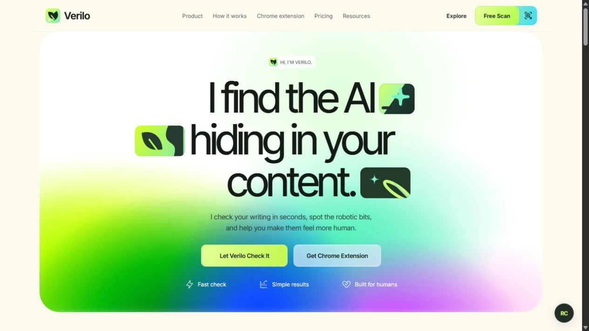

# Verilo

A complete responsive product landing page built with Next.js App Router, TypeScript, Inter/Inter Tight, Radix UI Accordion and Dialog, and Lucide icons.



## Run

```powershell
npm install
npm run dev -- --port 3200
```

Production: `npm run build`, then `npm run start -- --port 3200`. Type checking: `npx tsc --noEmit`.

## Scope

A landing-page design, as requested. Includes the rainbow hero, transparent character gallery, product overview, three-step workflow, audience use cases, illustrated closing CTA, FAQ, and footer. Sticky navigation, mobile dialog with focus management, section links, skip link, and keyboard-accessible accordion work. The page has no blue outer frame.

This is not a detector, authentication service, billing system, or published Chrome extension. Scan CTAs lead to the proposed workflow. Browser links describe the concept; the FAQ states its availability accurately. No fabricated scan results, customers, or testimonials are included.

## Original assets

Transparent WebP characters are in `public/characters/`. New transparent bot and desk illustrations are in `public/illustrations/`. Vector branding is in `public/brand/`. AI asset prompts and provenance are in `docs/asset-prompts.md`. Images use Next.js image optimization and preserve alpha channels. Fonts are bundled by Next.js at build time.
